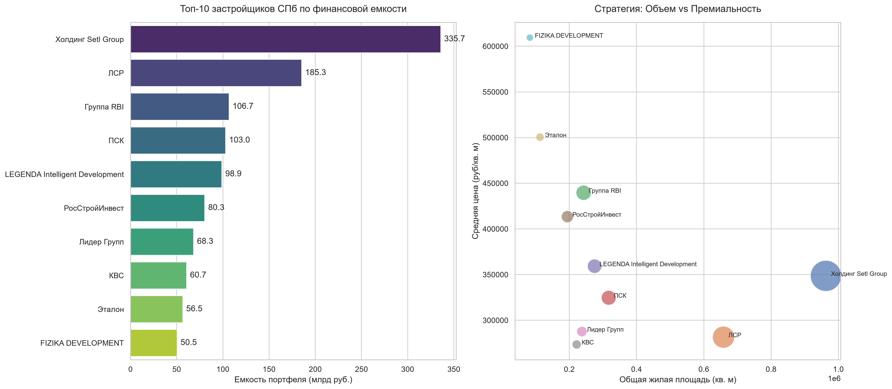
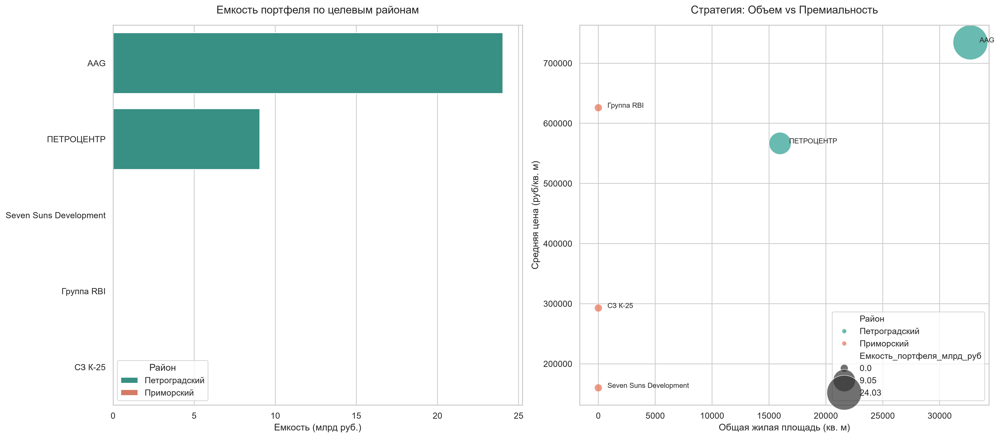

# Анализ рынка первичной недвижимости Санкт-Петербурга 🏢

## Описание проекта
End-to-end исследование финансовой емкости строящегося жилья в Санкт-Петербурге на основе скрытых API ЕИСЖС (ДОМ.РФ). Проект демонстрирует аналитический подход «Macro-to-Micro»: от макроэкономики (анализ топ-10 девелоперов города) к локальному срезу (сравнение Приморского и Петроградского районов).

## Бизнес-задача
* Рассчитать потенциальную выручку (емкость портфеля) ключевых девелоперов.
* Проанализировать ценовые стратегии (объем массовой застройки vs точечный премиум).
* Изучить распределение финансовой емкости в целевых районах.

## Стек технологий
* **Сбор данных:** `Python`, `requests`, `curl_cffi` (для обхода WAF и TLS-отпечатков).
* **Обработка данных:** `pandas`, `numpy`.
* **Визуализация:** `matplotlib`, `seaborn`.

## Технические вызовы и решения
1. **Обход анти-бот защиты:** Базовые запросы к API отклонялись (HTTP 403). Проблема решена перехватом актуальных токенов и эмуляцией TLS-отпечатка Chrome.
2. **Аномалии в данных (Скрытая площадь):** Обнаружено, что комплексы апартаментов и элитная недвижимость в реестре имеют нулевую жилую площадь, что ломало расчет средних цен. Настроена логика импутации: технические нули изолированы через `np.nan`, что позволило корректно рассчитать агрегированные метрики без искажений.

## Результаты исследования

### 1. Глобальный рынок (Топ-10 девелоперов)

* **Setl Group** и **ЛСР** — абсолютные лидеры по объему застройки.
* Бутик-девелоперы (FIZIKA DEVELOPMENT, RBI) компенсируют малый объем ввода сверхвысокой стоимостью квадратного метра.

### 2. Локальный срез (Петроградский vs Приморский районы)

* Отчетливо видна разница стратегий: масштабное освоение территорий в Приморском районе и точечная премиальная застройка на Петроградской стороне.

## Структура репозитория
* `clean_top10_market.py` / `visualize_top10_market.py` — глобальный анализ рынка.
* `clean_target_districts.py` / `visualize_target_districts.py` — анализ целевых районов.
* `requirements.txt` — зафиксированные зависимости окружения (`pip freeze`).
* Исходные `csv` датасеты и сгенерированные отчеты (`.png`).